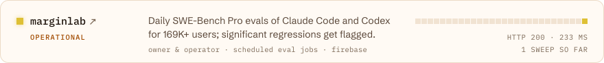
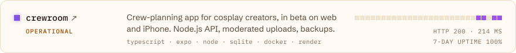
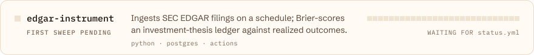
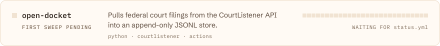
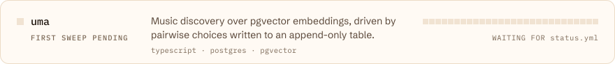
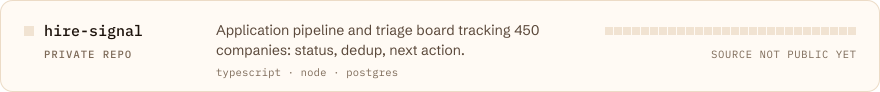
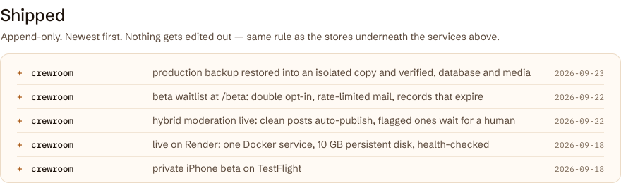
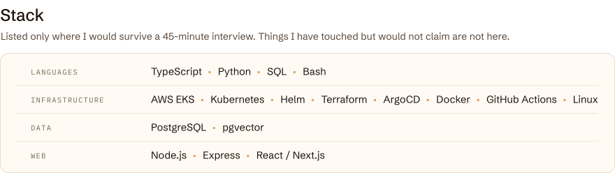

<!--
  Most of this file is drawn by tools/render.py from profile.toml and log/*.jsonl.
  Edit those, not the blocks between START/END markers (they get rewritten
  every six hours by .github/workflows/status.yml). Text outside the markers is yours.
-->
<!-- HERO:START -->

<a href="mailto:swegeraldogrell@gmail.com"><picture><source media="(prefers-color-scheme: dark)" srcset="https://raw.githubusercontent.com/Jikjii/Jikjii/main/assets/btn-email-dark.svg?v=f95faa27be"></picture></a>&nbsp;
<a href="https://www.linkedin.com/in/geraldo-grell/"><picture><source media="(prefers-color-scheme: dark)" srcset="https://raw.githubusercontent.com/Jikjii/Jikjii/main/assets/btn-linkedin-dark.svg?v=7f4b6eb77f"></picture></a>&nbsp;
<a href="https://jikjii.github.io/geraldo/assets/Geraldo_Grell_Resume.pdf"><picture><source media="(prefers-color-scheme: dark)" srcset="https://raw.githubusercontent.com/Jikjii/Jikjii/main/assets/btn-resume-dark.svg?v=0131e7bc5a"></picture></a>&nbsp;
<a href="https://jikjii.github.io/geraldo/"><picture><source media="(prefers-color-scheme: dark)" srcset="https://raw.githubusercontent.com/Jikjii/Jikjii/main/assets/btn-portfolio-dark.svg?v=471da25910"></picture></a>

<!-- HERO:END -->

 

<!-- BOARD:START -->
<picture><source media="(prefers-color-scheme: dark)" srcset="https://raw.githubusercontent.com/Jikjii/Jikjii/main/assets/board-dark.svg?v=7e5e7242c2"></picture>
<a href="https://marginlab.ai"><picture><source media="(prefers-color-scheme: dark)" srcset="https://raw.githubusercontent.com/Jikjii/Jikjii/main/assets/svc-marginlab-dark.svg?v=73f1e4d242"></picture></a>
<picture><source media="(prefers-color-scheme: dark)" srcset="https://raw.githubusercontent.com/Jikjii/Jikjii/main/assets/svc-crewroom-dark.svg?v=7e3a23987e"></picture>
<picture><source media="(prefers-color-scheme: dark)" srcset="https://raw.githubusercontent.com/Jikjii/Jikjii/main/assets/svc-edgar-instrument-dark.svg?v=bc60863dc9"></picture>
<picture><source media="(prefers-color-scheme: dark)" srcset="https://raw.githubusercontent.com/Jikjii/Jikjii/main/assets/svc-open-docket-dark.svg?v=bd13ebac90"></picture>
<picture><source media="(prefers-color-scheme: dark)" srcset="https://raw.githubusercontent.com/Jikjii/Jikjii/main/assets/svc-uma-dark.svg?v=d58408547d"></picture>
<picture><source media="(prefers-color-scheme: dark)" srcset="https://raw.githubusercontent.com/Jikjii/Jikjii/main/assets/svc-hire-signal-dark.svg?v=01f5f18c8a"></picture>
<!-- BOARD:END -->

Every six hours <a href="https://github.com/Jikjii/Jikjii/blob/main/.github/workflows/status.yml"><code>status.yml</code></a> probes each live service, reads its repo's latest Actions run, appends what it saw to an append-only log (<a href="https://github.com/Jikjii/Jikjii/blob/main/log/sweeps.jsonl"><code>log/sweeps.jsonl</code></a>), and redraws the rows above from that log. If a row says down, it is actually down.

 

<!-- SHIPPED:START -->
<picture><source media="(prefers-color-scheme: dark)" srcset="https://raw.githubusercontent.com/Jikjii/Jikjii/main/assets/shipped-dark.svg?v=321248dae3"></picture>
<!-- SHIPPED:END -->

 

<!-- STACK:START -->
<picture><source media="(prefers-color-scheme: dark)" srcset="https://raw.githubusercontent.com/Jikjii/Jikjii/main/assets/stack-dark.svg?v=45adb5bfa0"></picture>
<!-- STACK:END -->

 

<b>The longer version</b>

 

I came to software sideways. Physics concentration at Manhattan University, then a CS degree at WGU,
with a few years of unglamorous operations work in between — a bank branch running a core banking platform,
a residential facility where the life-safety system going down was a real problem and not a page in a runbook.

That background is why the work above looks the way it does. I am less interested in apps than in the thing
that has to keep running on Tuesday at 3 a.m. with nobody watching: the scheduled job, the append-only store
that survives a bad re-run, the deploy that either works or rolls back cleanly.

**Currently:** finishing my B.S. in Computer Science at WGU (November 2026), starting Georgia Tech's M.S. in
Computer Science in January 2027, running the services above, and looking for a team where infrastructure is a
first-class concern rather than something the backend engineers do on Fridays.

**Reach me:** swegeraldogrell@gmail.com

 

This README is rebuilt by a GitHub Action. If it looks stale, something in my own pipeline broke, and that is on me. Last sweep: <!-- UPDATED:START -->awaiting first sweep<!-- UPDATED:END -->

